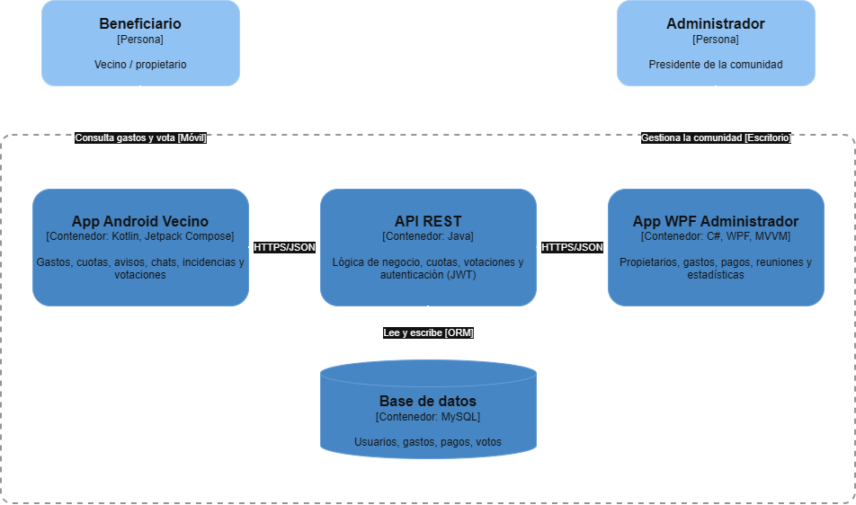

# Propuesta de Proyecto:
## Comunify

## Título del Proyecto
**Comunify**: Combina "Comunidad" y "Simplificar", queremos que sea más fácil controlar los gastos de la comunidad. 

## Datos del Equipo
---
- **Nombre del Proyecto:** Comunify
- **Equipo:** BalmisTech
- **Miembros del Equipo:**
  - Andrea Sarmiento Fornés (Hacedora)
  - Gor Ghazaryan (Analista)
  - Lucas Megías Ruano (Divergente)
  - Izan Catalá Garcia (Armonizador)
  - Maryna Prykhodko (Hacedora/Analista)
  - Marta Contreras López (Hacedora/Analista)
- **Curso:** 2ºDMA - IES Doctor Balmis 
- **Fecha de inicio:** Octubre 2026

## Alineación con los Objetivos de Desarrollo Sostenible (ODS)
---
Este proyecto se alinea directa y explícitamente con los siguientes Objetivos de Desarrollo Sostenible de las Naciones Unidas, tal como se requiere en la programación didáctica:

- **ODS 9 - Industria, innovación e infraestructura** al aplicar la innovación tecnológica para modernizar la gestión de las comunidades.
- **ODS 10 - Reducción de las desigualdades** al garantizar que todos los propietarios tengan el mismo acceso a la información y la misma capacidad de participar en las decisiones, sin importar si pueden asistir o no a las reuniones presenciales.

## Descripción del Problema
---
Podemos observar que en las comunidades de urbanizaciones y edificios resulta complicado llevar un seguimiento de los gastos de comunidad, observar quien ha pagado y quien no. Es complicado reunir a todos los propietarios para realizar reuniones y poder hablar dichos gastos y  problemas. Siempre hay gastos tardíos o simplemente la desconexión lleva a la desinformación. 

## Descripción de la Solución Propuesta
---
**Comunify** es una solución software multiplataforma diseñada para facilitar la gestión de comunidades de propietarios en edificios y urbanizaciones, centralizando el control de gastos, los pagos y la comunicación entre vecinos. El sistema constará de tres componentes principales, siguiendo la arquitectura definida en la programación:

1. **Aplicación Móvil para Vecinos (Android con Kotlin y Jetpack Compose):** Será la herramienta principal para los propietarios. Permitirá consultar los gastos de la comunidad y el estado de sus cuotas, recibir avisos de pagos pendientes, ver el historial de pagos, comunicar incidencias (averías, limpieza, ruidos…) y participar en reuniones y votaciones online sin necesidad de reunir a todos físicamente.

2. **Aplicación de Escritorio para Administradores (WPF con C# y MVVM):** Una herramienta de back-office para el presidente o el administrador de fincas. Permitirá gestionar propietarios y viviendas, registrar gastos y derramas, marcar qué vecinos han pagado y cuáles no, gestionar las incidencias, convocar reuniones y publicar actas, y obtener estadísticas sobre la situación económica de la comunidad (morosidad, gastos por mes, saldo disponible).

3. **Servicio Backend (API REST con Java):** El cerebro del sistema. Gestionará toda la lógica de negocio (cálculo de cuotas, control de pagos, votaciones), la persistencia de datos en una base de datos MySQL, la autenticación de usuarios mediante Sesiones o JWT y la comunicación segura entre la aplicación móvil y la de escritorio.

## Actores y Roles
---
- **Beneficiario:** Cualquier `habitante / propietario/a de una vivienda` que tiene gastos relacionados directamente con la comunidad.
- **Administrador:** Es un `habitante / propietario/a de una vivienda` que ejerce el rol de presidente de la comunidad que gestiona y 'modela' la plataforma a través de la aplicacion de escritorio. 
  
## Arquitectura general
---
La arquitectura de Comunify sigue un modelo cliente-servidor. Dos aplicaciones cliente (móvil para vecinos y escritorio para el administrador) se comunican con un único servicio backend, que es el único que accede a la base de datos. Se representa mediante un diagrama de contenedores del modelo C4.

| Contenedor                | Tecnología                    | Responsabilidad                                                                                                                                   |
| :------------------------ | :---------------------------- | :------------------------------------------------------------------------------------------------------------------------------------------------ |
| **App Android Vecino**    | Kotlin, Jetpack Compose (MVI) | Consultar gastos y cuotas, recibir avisos, chats, comunicar incidencias y votar. Usada por el Beneficiario.                                       |
| **App WPF Administrador** | C#, WPF (MVVM)                | Gestionar propietarios y viviendas, registrar gastos y derramas, marcar pagos, convocar reuniones y ver estadísticas. Usada por el Administrador. |
| **API REST**              | Java                          | Lógica de negocio (cuotas, pagos, votaciones), autenticación con Sesiones o JWT y punto único de acceso a los datos.                              |
| **Base de datos**         | MySQL                         | Persistencia de usuarios, viviendas, gastos, pagos, incidencias y votaciones.                                                                     |

**Comunicación:**
- Las apps cliente nunca acceden a la base de datos directamente; todo pasa por la API REST (HTTPS, JSON).
- La API REST accede a MySQL mediante un ORM.

## Casos de Uso Principales

### Para Beneficiarios | *usuarios* (App Móvil)
| Caso de Uso                  | Descripción                                                                                                                    | Prioridad |
| :--------------------------- | :----------------------------------------------------------------------------------------------------------------------------- | :-------- |
| **Inicio de Sesión**         | Permitir al vecino autenticarse de forma segura en la aplicación móvil con sus credenciales.                                   | Alta      |
| **Panel de Inicio**          | Visualizar el saludo personalizado, el estado de cuenta actual y accesos directos a gastos y avisos.                           | Alta      |
| **Historial de Gastos**      | Consultar el histórico de gastos de la comunidad organizado por meses y ver el desglose detallado (luz, agua, limpieza, etc.). | Alta      |
| **Sistema de Chats**         | Comunicarse a través de canales fijos de mensajería organizados por categorías: Presidente, Bloque, Comunidad y Avisos.        | Media     |
| **Informes de Recaudación**  | Visualizar los informes mensuales de recaudación globales de la comunidad.                                                     | Media     |
| **Recibir Notificaciones**   | Recibir notificaciones oficiales, avisos principales destacados y comunicados emitidos por la administración.                  | Alta      |
| **Participar en Votaciones** | Participar y emitir votos en consultas sobre reformas, mejoras o reparaciones en el edificio o urbanización.                   | Media     |

### Para Administradores (App Escritorio)

| Caso de Uso                             | Descripción                                                                                                                         | Prioridad |
| :-------------------------------------- | :---------------------------------------------------------------------------------------------------------------------------------- | :-------- |
| **Inicio de Sesión Seguro**             | Permitir al administrador autenticarse en el sistema con credenciales seguras.                                                      | Alta      |
| **Gestión de Propietarios**             | Consultar el listado de viviendas y propietarios, permitiendo altas, bajas y ver datos de contacto.                                 | Alta      |
| **Registro de Gastos y Derramas**       | Introducir las facturas mensuales de la comunidad desglosadas por conceptos (luz, agua, limpieza) y crear derramas extraordinarias. | Alta      |
| **Control de Pagos y Recibos**          | Asignar las cuotas a los vecinos y marcar quién ha pagado y quién tiene recibos pendientes.                                         | Alta      |
| **Validación de Justificantes**         | Revisar los comprobantes de transferencia bancaria enviados por los propietarios para saldar sus deudas.                            | Media     |
| **Publicación de Avisos y Comunicados** | Redactar y enviar avisos oficiales que aparecerán en la pantalla principal y en los chats de la app móvil.                          | Alta      |
| **Creación y Cierre de Votaciones**     | Publicar consultas sobre reformas o mejoras del edificio y consultar el recuento final de votos emitidos.                           | Media     |
| **Estadísticas e Informes Económicos**  | Consultar métricas del estado económico de la comunidad (saldo disponible, morosidad acumulada y gastos por mes).                   | Baja      |

## Riesgos y mitigación
---
| Riesgo                                          | Mitigación                                                                                                                                                  |
| :---------------------------------------------- | :---------------------------------------------------------------------------------------------------------------------------------------------------------- |
| **Chat en tiempo real**                         | Requiere el uso de Flows y corrutinas en Kotlin junto con Firebase o WebSockets para la mensajería por canales (Presidente, Bloque, Comunidad y Avisos).    |
| **Notificaciones push**                         | Uso de Firebase Cloud Messaging (FCM) para enviar avisos, comunicados y recordatorios de pagos pendientes.                                                  |
| **Integridad de las votaciones**                | Control en el backend de un único voto por vivienda, con votaciones con fecha de cierre y recuento calculado solo por la API.                               |
| **Errores en el cálculo de cuotas y derramas**  | Centralizar los cálculos en la API REST según el coeficiente de cada vivienda y cubrirlos con tests unitarios.                                              |
| **Subida de justificantes de pago**             | Limitar formatos (PDF/JPG/PNG) y tamaño de archivo, y almacenarlos de forma segura vinculados a cada recibo.                                                |
| **Protección de datos personales y económicos** | Comunicación por HTTPS, control de acceso por roles (VECINO, ADMIN) y cumplimiento del RGPD mostrando a cada vecino solo la información que le corresponde. |
| **Complejidad JWT**                             | Taller extra + plantilla base o uso de sesiones.                                                                                                            |
| **Conflictos en el repositorio**                | Trabajo en ramas por funcionalidad, avisar antes de trabajar en `main` y revisión antes de cada merge.                                                      |
| **Retraso en integración**                      | Feature-flags para desactivar las partes no críticas (chat, estadísticas).                                                                                  |
| **Scope creep**                                 | Definición clara del **Producto Mínimo Viable** (MVP) priorizando el backlog: gastos, pagos y avisos primero.                                               |
| **Falta de experiencia**                        | Uso de IA para generación de código y resolución de dudas.                                                                                                  |
| **Coordinación de un equipo de 6 personas**     | Reuniones semanales de seguimiento, reparto claro de tareas y comunicación por el grupo.                                                                    |

## Planificación aproximada Sprints por quincena
---
La planificación temporal sigue rigurosamente el marco establecido en la programación didáctica del módulo, dividiéndose en tres etapas: fase preparatoria inicial (semanas 1-8), fase de desarrollo colaborativo en equipo mediante **SCRUM** (Sprints 1 al 8, semanas 9 a 24) y fase de **desarrollo individual durante la Formación en Empresa (FE)** (semanas 25 a 32), culminando con la presentación final.

## Calendario de Sprints y Fases de Desarrollo
---
| Sprint  | Semanas | Fecha Inicio |     Fecha Fin      | Objetivo Principal                                    | Entregable Clave                                                                                                                                                                     |
| :-----: | :-----: | :----------: | :----------------: | :---------------------------------------------------- | :----------------------------------------------------------------------------------------------------------------------------------------------------------------------------------- |
|  **1**  |  9-10   |    09 nov    |       20 nov       | Prototipado UI/UX                                     | Prototipos navegables en Figma/Penpot de la App móvil (vistas de vecino y administrador) y de la App de escritorio para administración.                                              |
|  **2**  |  11-12  |    23 nov    | 04 dic **(1ª Ev)** | Modelo de dominio en C#, transpilación y mocks con IA | Clases de dominio C# (`Usuario`, `Vecino`, `Vivienda`, `Gasto`, `Cuota`, `Incidencia`, `Votacion`), transpiladas con IA a Kotlin y Java, junto con datasets sintéticos JSON para pruebas desacopladas. |
|  **3**  |  13-14  |    07 dic    |       18 dic       | Frontend Móvil (Android + MVI): UI                    | Implementación de pantallas en Android (Jetpack Compose + Material 3) para la App de beneficiarios, con navegación visual y previews.                                     |
|  **4**  |  15-16  |    07 ene    |       15 ene       | Frontend Móvil: Lógica funcional                      | Sprint Planning e integración de ViewModels (arquitectura MVI), lógica de interacción y consumo de "repositorios mock" de gastos, recibos e incidencias.                                           |
|  **5**  |  17-18  |    18 ene    |       29 ene       | Frontend Escritorio (WPF + MVVM): UI                  | Implementación de vistas XAML con WPF para la gestión administrativa de Comunify (listado de usuarios, moderación de publicaciones).                                                 |
|  **6**  |  19-20  |    01 feb    |       12 feb       | Frontend Escritorio: Lógica funcional                 | Implementación de ViewModels (patrón MVVM con CommunityToolkit), comandos e interacción conectando con datos mock de administración.                                                 |
|  **7**  |  21-22  |    15 feb    | 26 feb **(2ª Ev)** | Backend: API REST (CRUD)                              | Definición de entidades ORM y esquema MySQL. Endpoints CRUD completos para gestión de usuarios, gastos, recibos, derramas e incidencias.                                                      |
|  **8**  |  23-24  |    01 mar    |       12 mar       | Backend: API REST (Lógica de negocio)                 | Servicios con reglas de negocio (cálculo de cuotas por coeficiente, mayorías en votaciones, control de morosidad), DTOs y manejo centralizado de excepciones.                                |
| **FE**  |  25-28  |    15 mar    |       21 may       | Fase Formación en Empresa: Trabajo Individual         | Implementación de funcionalidades individuales avanzadas sin Scrum (evaluación con rúbrica individual por alumno).                                                                   |
| **Fin** |  33-34  |    24 may    |       04 jun       | Cierre, entrega y defensa                             | Memoria técnica final en Markdown (PROYECTO.md y DISENO.md), vídeo demostrativo del producto (2-3 min) y defensa oral del proyecto.                                                  |

## Reparto de Funcionalidades Individuales (Fase FE)
---
Durante la estancia en empresa (FE), cada miembro de BalmisTech desarrolla de forma autónoma una de las propuestas excluyentes del catálogo oficial:

1. **Andrea Sarmiento Fornés (Hacedora) - Integración Full-Stack Android:**
Conexión de la App Móvil (Jetpack Compose) con la API REST real mediante Retrofit y Corrutinas. Gestión del ciclo de vida del token de autenticación (JWT/Sesión) y sincronización en tiempo real del estado de cuenta, recibos y avisos del vecino.

2. **Gor Ghazaryan (Analista) - Seguridad, Roles y Documentación OpenAPI:**
Implementación en la API REST (Java) de los endpoints de autenticación, gestión de tokens JWT, control de acceso basado en roles (`VECINO`, `ADMIN`), encriptación de contraseñas y generación de la documentación interactiva con Swagger UI / OpenAPI.

3. **Lucas Megías Ruano (Divergente) - Integración Full-Stack Escritorio:**
Conexión de la App de Escritorio (WPF + MVVM) con la API REST mediante `HttpClient`. Implementación de la gestión administrativa completa de propietarios, asignación de cuotas, generación de derramas y validación de recibos pagados contra el servidor backend.

4. **Izan Catalá Garcia (Armonizador) - Módulo Full-Stack de Votaciones y Consultas Online:**
Desarrollo en backend y Android del sistema de votaciones para la comunidad: restricciones de emisión de un solo voto por vivienda, cálculo de mayorías en la API REST y pantalla visual interactiva de participación y recuento en tiempo real en la app móvil.

5. **Maryna Prykhodko (Hacedora/Analista) - Módulo Full-Stack de Gestión e Histórico de Incidencias:**
Desarrollo integral (API REST y WPF) del sistema de moderación de incidencias. Creación de endpoints backend para el filtrado, asignación de estados (Pendiente, En proceso, Resuelta) y costes asociados, junto con la interfaz de gestión en la app de escritorio para el administrador.

6. **Marta Contreras López (Hacedora/Analista) - Módulo Full-Stack de Reporte y Seguimiento de Incidencias:**
Desarrollo integral (Android + API REST) del flujo del vecino para comunicar averías, desperfectos o problemas de convivencia. Incluye formulario de reporte con subida de imágenes/capturas, listado personal de incidencias reportadas y visualización del estado de resolución en tiempo real.