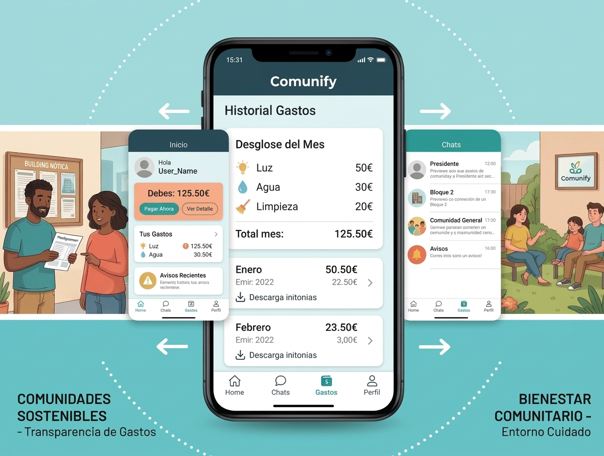

# Propueesta de Proyecto:
## Comunify

### Título del Proyecto
**Comunify**: Combina "Comunidad" y "Simplificar", queremos que sea más facíl controlar los gastos de la cominidad. 

{ style="display:block; margin:0 auto; width:80%;max-width:300px;" }

### Datos del Equipo
- **Nombre del Proyecto:** Comunify
- **Equipo:**
- **Miembros del Equipo:**
  -  Andrea Sarmeinto Fornés (Hacedora)
  - Gor (Analista)
  - Lucas (Divergente)
  - Izan Catalá Garcia (Armonizador)
  - Marina (Hacedora/Analista)
  - Marta (Hacedora/Analista)
- **Curso:** 2ºDMA - IES Doctor Balmis 
- **Fecha de inicio:** Octubre 2026

### Alineación con los Objetivos de Desarrollo Sostenible (ODS)

Este proyecto se alinea directa y explícitamente con los siguientes Objetivos de Desarrollo Sostenible de las Naciones Unidas, tal como se requiere en la programación didáctica:

### Descripción del Problema
### Descripción de la Solución Propuesta
**Comunify** es una solución software multiplataforma diseñada para servir de puente entre los habitantes del edificio y el presidente. El sistema constará de tres componentes principales, siguiendo la arquitectura definida en la programación:

### Actores y Roles
- **Beneficiario:** 
- **Administrador:**
### Arquitectura general

## Casos de Uso Principales
### Para Beneficiarios  (App Móvil)
### Para Administradores (App Escritorio)

### Riesgos y mitigación
## Planificación aproximada Sprints por quincena

La planificación temporal sigue rigurosamente el marco establecido en la programación didáctica del módulo, dividiéndose en tres etapas: fase preparatoria inicial (semanas 1-8), fase de desarrollo colaborativo en equipo mediante **SCRUM** (Sprints 1 al 8, semanas 9 a 24) y fase de **desarrollo individual durante la Formación en Empresa (FE)** (semanas 25 a 32), culminando con la presentación final.

### Calendario de Sprints y Fases de Desarrollo
| Sprint  | Semanas | Fecha Inicio |     Fecha Fin      | Objetivo Principal                                    | Entregable Clave                                                                                                                                                                     |
| :-----: | :-----: | :----------: | :----------------: | :---------------------------------------------------- | :----------------------------------------------------------------------------------------------------------------------------------------------------------------------------------- |
|  **1**  |  9-10   |    09 nov    |       20 nov       | Prototipado UI/UX                                     | Prototipos navegables en Figma/Penpot de la App móvil (vistas de donante y beneficiario) y de la App de escritorio para administración.                                              |
|  **2**  |  11-12  |    23 nov    | 04 dic **(1ª Ev)** | Modelo de dominio en C#, transpilación y mocks con IA | Clases de dominio C# (Usuario, Donante, Beneficiario, Cesta, Reserva, Ubicacion), transpiladas con IA a Kotlin y Java, junto con datasets sintéticos JSON para pruebas desacopladas. |
|  **3**  |  13-14  |    07 dic    |       18 dic       | Frontend Móvil (Android + MVI): UI                    | Implementación de pantallas en Android (Jetpack Compose + Material 3) para la App de donantes y beneficiarios, con navegación visual y previews.                                     |
|  **4**  |  15-16  |    07 ene    |       15 ene       | Frontend Móvil: Lógica funcional                      | Sprint Planning e integración de ViewModels (arquitectura MVI), lógica de interacción y consumo de repositorios mock de cestas y reservas.                                           |
|  **5**  |  17-18  |    18 ene    |       29 ene       | Frontend Escritorio (WPF + MVVM): UI                  | Implementación de vistas XAML con WPF para la gestión administrativa de FoodConnect (listado de usuarios, moderación de publicaciones).                                              |
|  **6**  |  19-20  |    01 feb    |       12 feb       | Frontend Escritorio: Lógica funcional                 | Implementación de ViewModels (patrón MVVM con CommunityToolkit), comandos e interacción conectando con datos mock de administración.                                                 |
|  **7**  |  21-22  |    15 feb    | 26 feb **(2ª Ev)** | Backend: API REST (CRUD)                              | Definición de entidades ORM y esquema MySQL. Endpoints CRUD completos para gestión de usuarios, cestas de alimentos y reservas.                                                      |
|  **8**  |  23-24  |    01 mar    |       12 mar       | Backend: API REST (Lógica de negocio)                 | Servicios con reglas de negocio (disponibilidad de stock, control de caducidad, bloqueo de solapamientos), DTOs y manejo centralizado de excepciones.                                |
| **FE**  |  25-28  |    15 mar    |       21 may       | Fase Formación en Empresa: Trabajo Individual         | Implementación de funcionalidades individuales avanzadas sin Scrum (evaluación con rúbrica individual por alumno).                                                                   |
| **Fin** |  33-34  |    24 may    |       04 jun       | Cierre, entrega y defensa                             | Memoria técnica final en Markdown (PROYECTO.md y DISENO.md), vídeo demostrativo del producto (2-3 min) y defensa oral del proyecto.                                                  |
### Reparto de Funcionalidades Individuales (Fase FE)

Durante la estancia en empresa (FE), cada miembro de BalmisTech desarrolla de forma autónoma una de las propuestas excluyentes del catálogo oficial:

1. **Andrea Sarminto Fornés (Hacedora) - Integración Full-Stack Android:**
Conexión de la App Android Jetpack Compose a la API REST real mediante Retrofit y Corrutinas, persistiendo el token JWT y completando el ciclo real de donación y reserva.
2. **Gor (Analista) - Seguridad, Roles y Documentación OpenAPI:**
Implementación en la API REST de endpoints de registro y login con JWT, autenticación stateless, control de acceso por roles (DONANTE, BENEFICIARIO, ADMIN) y documentación interactiva con Swagger UI.
3. **Lucas (Divergente) - Integración Full-Stack Escritorio:**
Conexión de la App WPF a la API REST de forma segura mediante HttpClient y JWT, permitiendo la moderación de publicaciones y validación de ONGs en tiempo real contra el servidor.
4. **Izan Catalá Garcia  (Armonizador) - Ampliación Funcional Full-Stack (Geolocalización):**
Integración de Google Maps SDK en la App Android para búsqueda visual de cestas cercanas por radio de distancia y desarrollo de endpoints backend para filtrado geoespacial.

**`Tambien tenemos a:`**
`5. Marina 6. Marta`